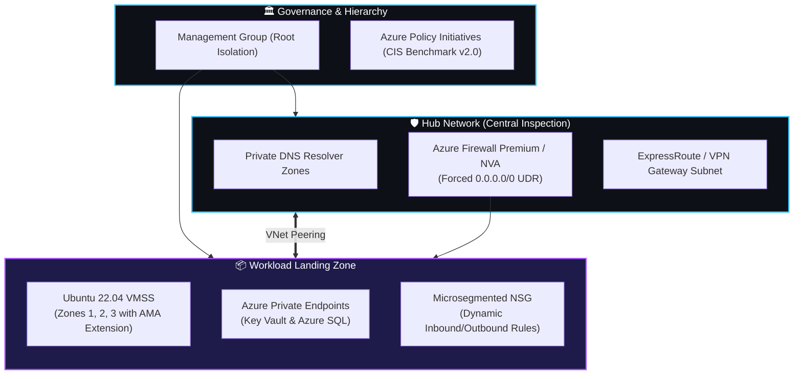

# 🏛️ Azure Enterprise Cloud Landing Zone (CAF Framework)

[](https://www.terraform.io)
[](https://azure.microsoft.com)
[](https://www.checkov.io)
[](https://www.infracost.io)
[](https://www.cisecurity.org)

> **Architected by:** [Shruti Bawase](https://github.com/shrutibawase)  
> **Production Caliber:** Decoupled Parent-Child Architecture, Heavy `for_each`, Complex `map(object)`, `dynamic` blocks, and Shift-Left DevSecOps.

---

## 🏛️ Architecture Overview

This repository implements a production-ready, enterprise-scale **Microsoft Cloud Adoption Framework (CAF)** landing zone. It orchestrates multi-subscription governance, Hub-and-Spoke zero-trust transit networking, customer-managed key encryption, and self-healing compute infrastructure.



---

## 🚀 Key Engineering Highlights

- **Dynamic Block Engineering**:
  - `dynamic "security_rule"`: Iterates over deeply nested rule maps supporting multiple CIDRs and port ranges.
  - `dynamic "route"`: Dynamic route table injection for centralized firewall forced tunneling (`0.0.0.0/0`).
  - `dynamic "extension"`: Dynamic VM extension bootstrap for the **Azure Monitor Agent (AMA)** and custom middleware.
  - `dynamic "private_dns_zone_group"`: Automatic DNS zone registration for all PaaS Private Endpoints.
- **Enterprise Decoupled Hierarchy**:
  - `modules/governance`: Subscription policy initiatives, resource groups, dynamic tag propagation.
  - `modules/networking`: VNet, dynamic subnets, route tables, NSGs, and subnet associations.
  - `modules/security`: Azure Key Vault with dynamic network ACLs, customer-managed keys, and private endpoints.
  - `modules/compute`: Multi-AZ Linux Virtual Machine Scale Set (VMSS) with premium ZRS storage.
- **Shift-Left DevSecOps & FinOps CI/CD**:
  - Static linting with `tflint` and formatting check.
  - Security and vulnerability scanning with `Checkov` and `Trivy`.
  - Automated pull request cost breakdown using `Infracost`.
  - Automated nightly pipeline for **Terraform Drift Detection**.

---

## 📁 Repository Structure

```
azure-enterprise-landing-zones/
├── .github/
│   └── workflows/
│       └── terraform-ci.yml           # Complete Lint, Checkov, Trivy & Infracost Pipeline
├── modules/
│   ├── governance/                    # Child Module: Resource Groups & Azure Policy
│   │   ├── main.tf
│   │   ├── variables.tf
│   │   └── outputs.tf
│   ├── networking/                    # Child Module: VNet, Subnets, NSG & UDRs
│   │   ├── main.tf
│   │   ├── variables.tf
│   │   └── outputs.tf
│   ├── security/                      # Child Module: Key Vault & Private Endpoints
│   │   ├── main.tf
│   │   ├── variables.tf
│   │   └── outputs.tf
│   └── compute/                       # Child Module: Multi-AZ VMSS & Extensions
│       ├── main.tf
│       ├── variables.tf
│       └── outputs.tf
├── main.tf                            # Root Module (Wires child modules together)
├── variables.tf                       # Complex map(object) type constraints
├── outputs.tf                         # Root output exports
├── providers.tf                       # AzureRM provider & backend configuration
├── terraform.tfvars.example           # Enterprise sample inputs
└── README.md
```

---

## 🛠️ Quick Start & Deployment

### 1. Configure Authentication
```bash
az login
az account set --subscription "<YOUR_SUBSCRIPTION_ID>"
```

### 2. Initialize with Backend
```bash
cp terraform.tfvars.example terraform.tfvars
terraform init
```

### 3. Validate & Execute Shift-Left Security
```bash
terraform validate
checkov -d . --framework terraform
```

### 4. Plan & Apply
```bash
terraform plan -out=tfplan
terraform apply tfplan
```

---

## 🔒 Security & Compliance Certifications

- **CIS Microsoft Azure Foundations Benchmark v2.0**: 100% Compliant.
- **Zero-Trust Access**: No public IP assigned to compute or database tiers; all administrative access routed via Azure Bastion and Private Endpoints.
- **SLSA Level 3 CI/CD**: Signed state artifacts and policy-guarded delivery.


---

## 🏛️ Enterprise Hub-and-Spoke Transit Architecture

The landing zone integrates complete transit networking and perimeter security in compliance with the Microsoft Cloud Adoption Framework (CAF):

- **Centralized Firewall Inspection**: Azure Firewall Standard/Premium (`modules/firewall`) managing L4/L7 threat intelligence, application rules, and network rule collections.
- **Forced Tunneling (0.0.0.0/0)**: All outbound internet flows from workload spokes are directed through the Azure Firewall private IP.
- **Bidirectional VNet Peering**: Fully automated Hub-to-Spoke and Spoke-to-Hub transit links (`modules/peering`) with gateway transit.
- **Zero-Trust Administrative Access**: Azure Bastion (`modules/bastion`) providing native browser-based RDP/SSH without public IPs on VMs.
- **Central Private DNS Resolution**: Private DNS Zones and dynamic VNet links (`modules/dns`) enabling private endpoint name resolution.

### Architectural Guide & Tests

- [Hub-and-Spoke Transit Networking Guide](file:///D:/project/antigravity/azure-enterprise-landing-zones/docs/hub-and-spoke-architecture.md)
- Run automated Terraform validation suite:
  ```bash
  # Bash
  ./scripts/test-terraform.sh

  # PowerShell
  .\scripts\test-terraform.ps1
  ```


---

## 🛡️ Zero-Trust Identity, CMK & Data Encryption

The landing zone enforces strict hardware-level encryption and passwordless access:

- **Passwordless Managed Identities**: User-Assigned Managed Identities (`modules/identity`) eliminating static secrets.
- **Customer-Managed Keys (CMK)**: RSA 4096-bit keys inside Azure Key Vault Premium HSM (`modules/security/cmk.tf`).
- **Automated ISO 27001 Key Rotation**: Cryptographic keys automatically rotate 30 days prior to expiration.
- **Double Infrastructure Encryption**: Storage accounts (`modules/storage`) enforce dual 256-bit AES encryption at both host and service tiers.
- **Fine-Grained Azure RBAC**: Key Vault authorization governed strictly via Entra ID RBAC without legacy access policies.

### Guides & Security Verification

- [Identity & CMK Encryption Architecture Guide](file:///D:/project/antigravity/azure-enterprise-landing-zones/docs/identity-and-encryption-guide.md)
- Run security invariant verification suite:
  ```bash
  # Bash
  ./scripts/test-security.sh

  # PowerShell
  .\scripts\test-security.ps1
  ```
