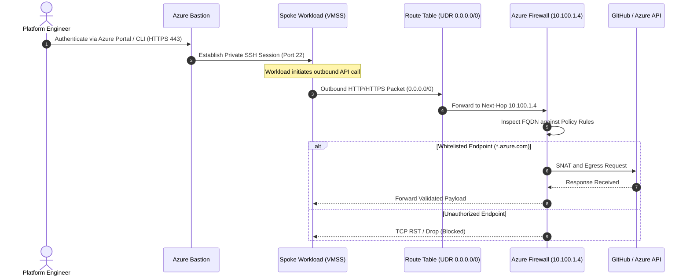

# Enterprise Hub-and-Spoke Transit Networking Architecture

## 1. Executive Summary & Design Principles

This repository implements the **Microsoft Cloud Adoption Framework (CAF)** enterprise-scale landing zone network topology.

The design enforces a strict separation of concerns:
- **Centralized Hub Network:** Concentrates perimeter security, ingress/egress inspection, cross-premises hybrid transit (ExpressRoute/VPN), shared DNS resolution, and zero-trust jump-host access.
- **Isolated Spoke Networks:** Contain enterprise application workloads (compute, containers, data persistence). Spokes have no direct Internet gateways or public IPs; all outbound communication is forcibly routed through the Hub.

```mermaid
flowchart TB
    subgraph INTERNET["Public Internet & SaaS"]
        APIS["Whitelisted Cloud Endpoints\n(*.azure.com, ghcr.io, *.ubuntu.com)"]
    end

    subgraph HUB["ðŸ›¡ï¸  Enterprise Hub VNet (10.100.0.0/16)"]
        direction TB
        FW["Azure Firewall (AZFW_VNet)\nPrivate IP: 10.100.1.4\n(Threat Intel, App/Net Rules)"]
        BST["Azure Bastion Host\n(TLS Browser Broker)"]
        DNS["Private DNS Zones\n(privatelink.vaultcore.azure.net)"]
        GW["GatewaySubnet\n(ExpressRoute / VPN)"]
    end

    subgraph SPOKE1["📦 Workload Spoke A (10.100.10.0/24)"]
        VMSS["Linux VMSS Cluster\n(Ubuntu 22.04 LTS Gen2)"]
        PE["Private Endpoints\n(Azure Key Vault)"]
    end

    subgraph SPOKE2["📦 Workload Spoke B (10.100.20.0/24)"]
        DB["Data / Persistence Tier\n(Private Endpoint Access)"]
    end

    INTERNET <==>|Filtered Egress| FW
    HUB <==>|VNet Peering (Gateway Transit)| SPOKE1
    HUB <==>|VNet Peering (Gateway Transit)| SPOKE2
    SPOKE1 -.->|Forced UDR 0.0.0.0/0| FW
    SPOKE2 -.->|Forced UDR 0.0.0.0/0| FW
    FW -.->|Inspected East-West Transit| SPOKE2
    BST -.->|Zero-Trust SSH| VMSS
```

---

## 2. Core Architectural Pillars

### 2.1 Centralized Egress via Azure Firewall
- All Spoke subnets possess a **User-Defined Route (UDR)** table with route `0.0.0.0/0` targeting the private IP of the Azure Firewall as the `VirtualAppliance` next hop.
- The firewall evaluates requests against **Application Rule Collections** (FQDN matching for Azure APIs, GitHub, Ubuntu package repositories) and **Network Rule Collections** (DNS 53, NTP 123). Unmatched outbound flows are dropped.

### 2.2 Bidirectional VNet Peering
- Peering links are established using the `modules/peering` module.
- `allow_forwarded_traffic = true` ensures that packets routed from one spoke through the firewall can reach another spoke without SNAT.
- `allow_gateway_transit` and `use_remote_gateways` streamline future ExpressRoute or S2S VPN gateway integration.

### 2.3 Zero-Trust Administrative Access (Azure Bastion)
- Workload virtual machines are provisioned with **zero public IP addresses**.
- Remote SSH and RDP management is performed through **Azure Bastion** in `modules/bastion`, terminating TLS at the perimeter and brokering sessions securely.

### 2.4 Centralized Private DNS Resolution
- Private endpoints in Spoke VNets register their internal A-records into centralized **Azure Private DNS Zones** in the Hub (`modules/dns`).
- Virtual network links bridge the zones across all spokes, enabling seamless private name resolution across the entire enterprise estate.

---

## 3. Traffic Flow Sequence



---

## 4. Verification & Testing

Run the automated Terraform validation suite:

```bash
# Linux / macOS
./scripts/test-terraform.sh

# Windows PowerShell
.\scripts\test-terraform.ps1
```
