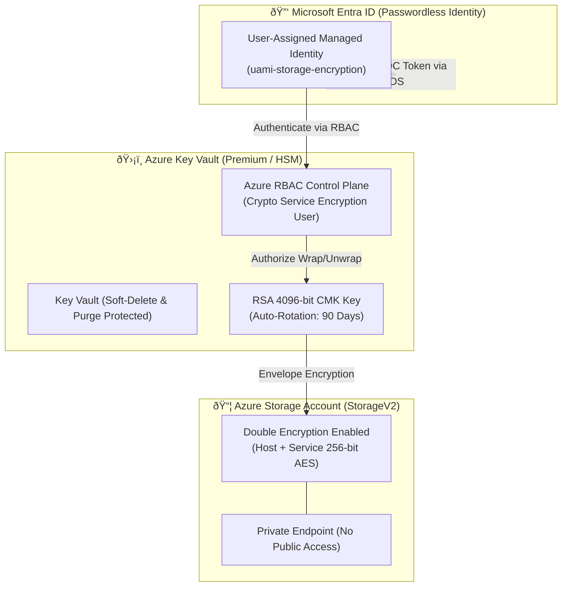

# Zero-Trust Identity, Customer-Managed Keys (CMK) & Data Encryption Architecture

## 1. Executive Summary

This architecture establishes a **Zero-Trust Identity and Data Protection** baseline across the enterprise landing zone. It eliminates static credentials via **Microsoft Entra ID Managed Identities**, enforces **FIPS 140-2 Level 3** hardware-backed encryption with **Customer-Managed Keys (CMK)**, and applies **automated cryptographic key rotation** compliant with ISO/IEC 27001 standards.



---

## 2. Core Security Pillars

### 2.1 Passwordless Workload Authentication
- **Zero Static Secrets:** Workloads authenticate to Azure services using **User-Assigned Managed Identities (UAMI)** provisioned via `modules/identity`.
- Tokens are acquired in-memory using Azure Instance Metadata Service (IMDS) at `http://169.254.169.254/metadata/identity/oauth2/token`.
- Eliminates credential rotation overhead and completely prevents secret leaks in repositories or build logs.

### 2.2 Customer-Managed Keys (CMK) with Hardware Security Modules (HSM)
- All data at rest is encrypted using **RSA 4096-bit asymmetric keys** held inside an Azure Key Vault Premium HSM (`modules/security/cmk.tf`).
- **Purge Protection:** Prevents malicious or accidental permanent deletion of keys during security incidents.
- **Envelope Encryption:** The CMK encrypts a symmetric Data Encryption Key (DEK). The storage service only receives the encrypted DEK and must ask Key Vault to unwrap it during I/O operations.

### 2.3 Automated Cryptographic Key Rotation (ISO/IEC 27001)
- Key Vault evaluates an automated rotation policy:
  - `time_before_expiry = "P30D"`: Key Vault automatically provisions a new key version 30 days before expiration.
  - `expire_after = "P365D"`: Limits maximum key lifespan to 12 months.
  - `notify_before_expiry = "P29D"`: Triggers Event Grid alerts to security monitoring tools.

### 2.4 Infrastructure Double Encryption
- Azure Storage (`modules/storage`) is provisioned with `infrastructure_encryption_enabled = true`.
- Data is encrypted twice: once at the service layer using the Customer-Managed Key (CMK), and once at the physical storage host layer using platform keys with distinct 256-bit AES keys.

### 2.5 Role-Based Access Control (RBAC) Segregation of Duties
Traditional Key Vault access policies are disabled (`enable_rbac_authorization = true`). Permissions are governed through precise Entra ID role assignments:

| Role Name | Role Definition ID | Assigned Principal | Scope |
|---|---|---|---|
| **Key Vault Crypto Service Encryption User** | `e1406121-a720-496a-a4eb-3d579ebd12bc` | Storage / Compute Managed Identities | Key Vault Key scope |
| **Key Vault Secrets Officer** | `b86a8fe4-44ce-4948-aee5-eccb2a155cd7` | CI/CD Pipeline Service Principal | Key Vault scope |
| **Key Vault Reader** | `210e26d8-ea11-4723-9300-4e2a17f61a27` | Cloud Security Auditors | Resource Group scope |

---

## 3. Verification Commands

Run the automated security compliance test suite:

```bash
# Linux / macOS
./scripts/test-security.sh

# Windows PowerShell
.\scripts\test-security.ps1
```
