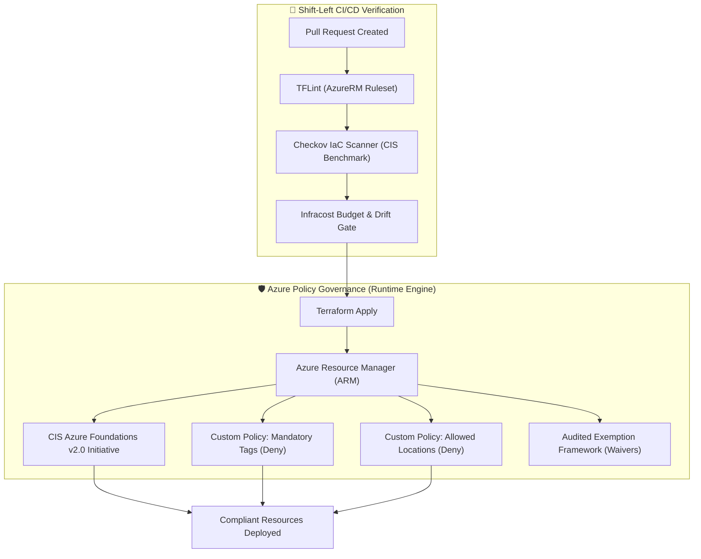

# Policy-as-Code, CIS Azure Benchmark & FinOps Architecture

## 1. Executive Summary & Governance Model

This module delivers automated, shift-left enterprise governance for the landing zone. It marries **Azure Policy Engine (Policy-as-Code)** enforcement at runtime with pre-deployment **Static Analysis (TFLint, Checkov)** and **Cost Guardrails (Infracost)** in the CI/CD pipeline.



---

## 2. Core Governance Pillars

### 2.1 CIS Microsoft Azure Foundations Benchmark v2.0
The subscription is bound to the official built-in initiative `CIS Microsoft Azure Foundations Benchmark v2.0.0` (`policySetDefinitions/0640751e-b507-4a6c-ac5e-e4793f18a5e7`). It actively audits and enforces:
- **Identity & Access Management:** Multi-factor authentication, privileged identity management, and service principal hygiene.
- **Data Protection:** Encryption-at-rest for storage, databases, and key vaults with customer-managed keys.
- **Network Perimeter:** Elimination of unrestricted inbound SSH/RDP and non-approved egress.

### 2.2 Custom Azure Policy Definitions
Located in `modules/governance/policies/`:

| Policy Name | Effect | Evaluation Rule |
|---|---|---|
| **`custom-enforce-mandatory-tags`** | `Deny` | Blocks provisioning of any resource lacking `Environment`, `CostCenter`, or `ManagedBy` tags. |
| **`custom-allowed-azure-locations`** | `Deny` | Restricts resource deployment strictly to authorized regions: `eastus2` and `centralus`. |

### 2.3 Time-Bound Policy Exemptions
To support audited, temporary architectural exceptions without compromising global baselines, the landing zone leverages `azurerm_subscription_policy_exemption`:
- **Categories:** `Mitigated` (compensating controls in place) or `Waiver` (executive sign-off).
- **Expiration:** Automated revocation through `expires_on` timestamp attributes.

### 2.4 Shift-Left DevSecOps & FinOps
1. **TFLint (`.tflint.hcl`):** Runs the official `tflint-ruleset-azurerm` plugin to enforce naming standards, catch invalid resource arguments, and detect deprecated attributes before plan execution.
2. **Checkov (`.checkov.yml`):** Scans all Terraform code for misconfigurations against CIS Benchmarks with zero-soft-fail policy.
3. **Infracost (`infracost.yml`):** Calculates exact cost impacts of every pull request, warning engineering teams of unintended budget increases.

---

## 3. Verification Commands

Run the automated governance test suite:

```bash
# Linux / macOS
./scripts/test-governance.sh

# Windows PowerShell
.\scripts\test-governance.ps1
```
